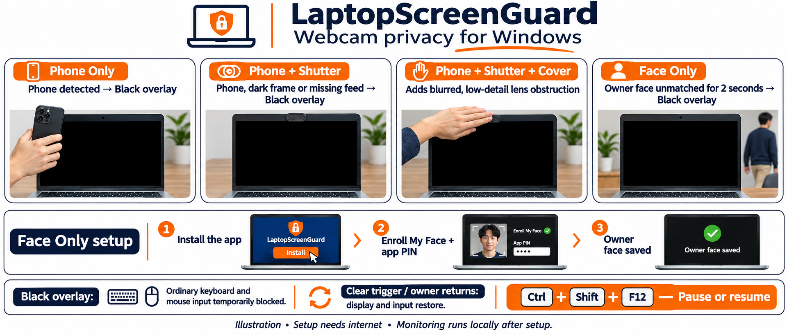

# LaptopScreenGuard

**Your screen. Your space.**

LaptopScreenGuard is a Windows webcam privacy tool that displays a black overlay when your selected trigger is detected. It also attempts to block keyboard and mouse input while the overlay is active.

Choose from four standalone editions: phone detection, phone with shutter monitoring, phone with lens-cover checks, or enrolled-face monitoring.

**Created by [Sanjeev Kumar](https://isanjiiv.github.io/) · IT Engineer**

[Explore the Repository](https://github.com/isanjiiv/LaptopScreenGuard) · [Report an Issue](https://github.com/isanjiiv/LaptopScreenGuard/issues)

---

## How it works



1. The app monitors its selected trigger through your webcam.
2. When the trigger becomes active, a black overlay covers the display.
3. The app attempts to suppress keyboard and mouse input while the overlay is visible.
4. When the trigger clears, the overlay disappears and ordinary input resumes.

Webcam processing runs locally. After the initial dependency and model downloads, monitoring works offline.

> LaptopScreenGuard is a visual privacy overlay. It does not replace Windows account locking or prevent screenshots, screen recording, or all photography.

## Latest updates

- LaptopScreenGuard branding in the application and system-tray icons.
- Updated installers that copy the included logo automatically.
- Live camera preview during Face Only enrollment and replacement.
- Compact horizontal enrollment window with camera preview on the left and PIN fields and Capture button on the right.
- Face bounding box and guidance for lighting, distance, blur and multiple faces.
- An update script for existing installations.

## Download your edition

| Edition | What activates the overlay | Download |
| --- | --- | --- |
| **01 — Phone Only** | A phone detected in the webcam’s view | [Download ZIP](downloads/LaptopScreenGuard-01-Phone-Only.zip?raw=true) |
| **02 — Phone + Shutter** | A phone, or dark, uniform or unavailable webcam feed | [Download ZIP](downloads/LaptopScreenGuard-02-Phone-and-Shutter.zip?raw=true) |
| **03 — Phone + Shutter + Cover** | Phone and shutter checks, plus blurred or low-detail lens-cover checks | [Download ZIP](downloads/LaptopScreenGuard-03-Phone-Shutter-and-Cover.zip?raw=true) |
| **04 — Face Only** | No match to the enrolled face for about two seconds | [Download ZIP](downloads/LaptopScreenGuard-04-Face-Only.zip?raw=true) |

**Install one edition at a time for each Windows account.**

Face Only uses face matching as its trigger. It does not run separate phone, shutter or lens-cover detection rules. Covering the camera can still hide the enrolled face and activate its absence rule.

Shutter and cover checks infer conditions from the camera feed. Lighting and the type of obstruction can affect results.

## Requirements

- Windows 10 or Windows 11, 64-bit.
- Python 3.12, 64-bit, on an Intel/AMD x64 laptop.
- A working webcam with camera permissions enabled.
- Internet access during initial installation.
- Adequate lighting for face enrollment and matching.

## Install on a new laptop

### 1. Install Python

Download **Python 3.12 x64** from:

https://www.python.org/downloads/windows/

During installation, enable **Add python.exe to PATH** if offered.

Open a new Command Prompt and check:

```cmd
py -3.12 --version
```

Expected output:

```text
Python 3.12.x
```

You can also check:

```cmd
python --version
```

### 2. Download and extract one edition

Download your preferred ZIP from the table above.

Right-click the ZIP → **Extract All**.

Keep all extracted files together, including:

```text
LaptopScreenGuard.pyw
LaptopScreenGuard.png
Install-LaptopScreenGuard.cmd
Update-Existing-Installation.cmd
Uninstall-LaptopScreenGuard.cmd
START-HERE.txt
```

Do not run the installer directly from inside the ZIP.

### 3. Run the installer

Exit any older LaptopScreenGuard or PhoneScreenGuard instance first.

Under the Windows account that will use the app, double-click:

```cmd
Install-LaptopScreenGuard.cmd
```

Keep the internet connected while dependencies and models download. Wait for **Setup complete**.

The installer starts the app in the background.

### 4. Find the tray icon

Open the hidden-icons arrow near the Windows clock.

Look for the **LaptopScreenGuard laptop-and-shield logo**. Hover over it to check the edition and status.

Right-click the icon to access available controls.

### 5. Complete enrollment if using Face Only

Follow the enrollment steps below.

### 6. Test automatic startup

Sign out and sign back in. Confirm the app starts and appears in the tray.

Startup is configured for the installing Windows account. Other accounts require their own setup.

## Face Only — enroll your face

1. Open your camera shutter.
2. Sit alone in good light, facing the webcam.
3. Right-click the LaptopScreenGuard tray icon.
4. Select **Enroll My Face**.
5. A compact horizontal enrollment window opens:
   - **Left:** live mirrored camera preview and face box.
   - **Right:** PIN fields, Cancel and Capture & Enroll.
6. Follow the guidance until your face is ready.
7. Choose and confirm an app PIN containing at least **six digits**.
8. Click **Capture & Enroll**.
9. After the success message, the window closes and monitoring resumes.

The overlay and input blocking are temporarily suspended while the enrollment window is open.

### Preview guidance

| Message or condition | What to do |
| --- | --- |
| No face detected | Open the shutter and face the camera |
| More than one face detected | Sit alone in the camera’s view |
| Move closer | Bring your face closer to the webcam |
| Keep your whole face inside the preview | Adjust your position |
| Face too dark | Add light in front of you |
| Hold still / check focus | Stop moving and let the camera focus |
| Face ready | Enter your PIN and click Capture & Enroll |

### Replace the enrolled face

1. Right-click the tray icon.
2. Select **Replace Enrolled Face**.
3. Enter your **existing app PIN**.
4. Position the new face in the live preview.
5. Click **Capture & Enroll**.

Canceling enrollment preserves the existing saved profile.

Repeat enrollment separately on each laptop and Windows account.

## Update an existing installation

Use the update script when the app and its dependencies are already installed.

1. Download and fully extract the updated ZIP.
2. Choose the edition you want installed. To retain your current mode, select the matching edition.
3. Exit the running app from its tray menu.
4. Run:

```cmd
Update-Existing-Installation.cmd
```

5. Check the new tray icon and test monitoring.

The updater backs up the previous Python file as:

```text
LaptopScreenGuard.pyw.bak
```

For Face Only, the update preserves the existing enrolled-face file and app PIN.

> Modes 1–3 share one installation folder. Updating from a different phone-edition ZIP changes the installed edition to that ZIP’s mode.

For a fresh laptop, use **Install-LaptopScreenGuard.cmd** instead.

## Test and recover

Before regular use, test:

- Your edition’s detection trigger.
- Overlay appearance and removal.
- Keyboard and mouse restoration.
- Owner matching in Face Only.
- Automatic startup after sign-in.
- Processor usage on the target laptop.

### Pause or resume monitoring

```text
Ctrl + Shift + F12
```

### Open Windows security options

```text
Ctrl + Alt + Delete
```

### Lock your Windows session

```text
Windows + L
```

Use Windows locking when leaving your laptop unattended.

## Installation paths

| Edition | Installed location |
| --- | --- |
| Modes 1–3 | `%USERPROFILE%\LaptopScreenGuard` |
| Face Only | `%USERPROFILE%\LaptopScreenGuard-Face-Only` |

The installation belongs to the signed-in Windows account.

## Diagnostic commands

Exit the existing app before launching a diagnostic instance.

### Modes 1–3

```cmd
"%USERPROFILE%\LaptopScreenGuard\venv\Scripts\python.exe" "%USERPROFILE%\LaptopScreenGuard\LaptopScreenGuard.pyw"
```

### Face Only

```cmd
"%USERPROFILE%\LaptopScreenGuard-Face-Only\venv\Scripts\python.exe" "%USERPROFILE%\LaptopScreenGuard-Face-Only\LaptopScreenGuard.pyw"
```

Keep Command Prompt open while checking errors.

### Start Face Only in the background

```cmd
start "" "%USERPROFILE%\LaptopScreenGuard-Face-Only\venv\Scripts\pythonw.exe" "%USERPROFILE%\LaptopScreenGuard-Face-Only\LaptopScreenGuard.pyw"
```

Check `LaptopScreenGuard.log` in the installation folder for errors.

## Troubleshooting

### Python not found

Open a fresh Command Prompt after installing Python.

Check:

```cmd
py -3.12 --version
```

If unavailable, modify or reinstall Python 3.12 x64 and enable its PATH option.

### Camera preview is unavailable

- Open the physical shutter.
- Enable camera access for desktop apps in Windows Settings.
- Close other applications using the webcam.
- Check the camera works in the Windows Camera app.
- If necessary, adjust `CAMERA_INDEX` in the Python source.

Carry forward a custom camera index when updating the program.

### The old icon still appears

Exit the running app before applying the update.

Confirm `LaptopScreenGuard.png` exists beside the installed Python file. Restart the app and check the tray again.

### Face enrollment does not complete

Use good lighting and show exactly one face. Follow the preview guidance and confirm that both PIN entries match.

For face replacement, use the existing enrollment PIN.

### The app does not start after sign-in

Press **Windows + R** and enter:

```text
shell:startup
```

Check for the appropriate LaptopScreenGuard startup entry.

Disable obsolete PhoneScreenGuard or duplicate startup entries so multiple webcam monitors do not launch together.

## Privacy and limitations

- Webcam processing runs locally after setup.
- Webcam photos are not saved by the app.
- Face Only stores a local face embedding and salted app PIN hash.
- Detection depends on lighting, camera quality, processor performance and positioning.
- Webcam face matching may accept a photo or video.
- Input suppression is attempted and must be tested on the target system.
- This is a preview project. Live Windows installation, webcam behavior, tray rendering and recovery require testing on each target laptop.

## Uninstall

1. Exit LaptopScreenGuard from the tray.
2. Run:

```cmd
Uninstall-LaptopScreenGuard.cmd
```

Uninstalling Face Only also removes its local enrollment and PIN data.

## Repository structure

| Location | Contents |
| --- | --- |
| `downloads/` | Four full installer ZIPs |
| `src/` | Matching Python source, installers, updater scripts and logo |
| `assets/` | README and website images |
| `README.md` | Installation and usage guide |

## Dependencies

Dependencies and models retain their own licenses and distribution terms.

- [Ultralytics licensing](https://www.ultralytics.com/license)
- [OpenCV Zoo models](https://github.com/opencv/opencv_zoo)

## Feedback

When reporting an issue, include:

- Windows and Python versions.
- Edition installed.
- Steps to reproduce the issue.
- Relevant log messages.

Do not upload your PIN or `owner-face.npz` enrollment file.

[Open an issue](https://github.com/isanjiiv/LaptopScreenGuard/issues)

---

Built by **[Sanjeev Kumar](https://isanjiiv.github.io/)**.

---
## 🌐 Connect with the Creator

Created by **[Sanjeev Kumar](https://isanjiiv.github.io/)** — IT Engineer.

[](https://isanjiiv.github.io/)
[](https://www.instagram.com/isanjiiv/)
[](https://www.linkedin.com/in/isanjiiv/)
[](https://www.youtube.com/@isanjiiv)
[](mailto:sanjeev753304@gmail.com)
[](https://x.com/isanjiiv)
[](https://github.com/isanjiiv)

Feedback, testing suggestions and contributions are welcome!

---
